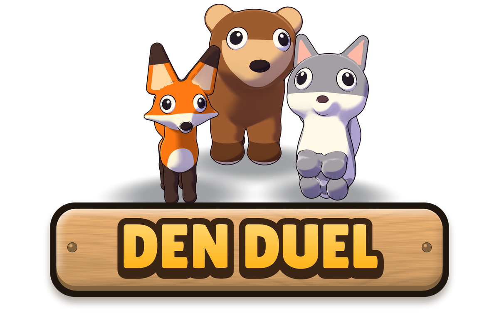

# Den Duel



**Play it in your browser:** https://idbloodworth03-debug.github.io/immakingagameidkwhattocall/
(on an iPhone, open it in Safari and *Add to Home Screen*; see below)

Den Duel is an animal battler for iOS and Android, made with Godot 4. In
**Draft Duel** you make 3 picks each round (new animals, tools, or stars for
animals you have), and the herds fight it out on their own on an open field,
each animal in its class's row. First to 4 round wins takes the match. You
free animals from cages (they become your draft pool) and climb through
arenas. The rarer the card, the rarer the animal in real life: Commons are
Least Concern species, Legendaries are Critically Endangered.

## What works today

Everything runs offline on your computer, saved on the device:

- **Menus:** five tabs laid out like other mobile card games (Shop, Animals, Battle, Clan, Events)
- **Cards:** 20 animals in 4 rarities, each with stats and an ability, plus 6 Ranger tools (37 more animals are designed and waiting)
- **Collection:** the animals and tools you've freed are your Draft Duel starters and shop, at their levels; level them up with copies and gold
- **Trophies:** 12 arenas on a Trophy Road, and new animals unlock as you climb
- **Cages:** 6 kinds of cage (our chests), with unlock timers, gem skips and a drop-odds screen
- **Ranger level:** an account level, plus player banners, icons and emotes to unlock
- **Shop:** daily animal offers, cages, gold packs and cosmetics
- **Draft Duel** against named Rival Rangers, best of 7 (first to 4 round wins). Each round you make 3 picks (round 1: 3 starting animals from your collection; then from 5 offered animals and tools, or a star for a herd animal), and the herds fight on their own by class: Tanks in front, Tank Destroyers in the middle, Ranged at the back, Air over the middle, Specialists where their trait works best. Rally once and use each tool once a fight. Each arena's boss guards the way to the next one. See "Draft Duel" in [docs/GAME_DESIGN.md](docs/GAME_DESIGN.md).
- **Look and feel:**
  - every animal is a 3D render, with fur, real markings and its own walk and attack animations (made by our Blender pipeline in `tools/creatures/`)
  - 12 rendered arenas: an open, fenced field with themed scenery around it
  - polished cartoon menus: glossy pressable buttons, raised panels, cards with rarity rims and portraits, an icon tab bar, and popups that pop in
  - chunky mobile-game fonts
  - a fake-3D finish on every animal (a highlight from the top-left, a cool rim light, soft volume shading, outlines in a dark shade of its own colors)
  - smooth, bouncy animation: breathing, walking hops, squash and stretch, wind-ups and lunges, pop-ins, and cartoon poof-and-stars defeats
  - combat juice: white hit flashes, knockback, hit sparks, hit-stop and screen shake on big hits, bouncy damage numbers, chunky health bars with a delayed "damage taken" bar
  - particles (sparkles, stars, puffs, confetti, coins), drifting cloud shadows, swaying grass and petals or snow, bouncy buttons and popups
  - sound effects and music, which players can switch off
- **Tests:** 105 automated tests for the rules, the fight engine and Draft Duel, plus a report that plays bot-vs-bot matches

Not built yet:

- online play and clans
- 3D-rendered tool effects and cages to match the animals (see [docs/ART_DIRECTION.md](docs/ART_DIRECTION.md))
- store purchases

See [docs/ROADMAP.md](docs/ROADMAP.md).

## Run it

1. Install **Godot 4.7** (the *Standard* version, not .NET) from https://godotengine.org/download
2. Get this repository onto your computer. With GitHub Desktop: *File > Clone repository*.
   Until this work is merged, switch to the branch `claude/funny-brown-sxbcoj`.
3. Open Godot, click **Import**, pick `game/project.godot`, then **Import & Edit**.
4. Press **F5** (or the play button in the top right) to run.

The window is phone-shaped, and a mouse click counts as a tap. Tap your banner
in the top left to open your profile. In test builds the profile has
**developer tools**: free gold and gems, trophies, skipping cage timers,
unlocking every animal and resetting your save.

## Play on your iPhone (web version)

Den Duel also runs as a website in Safari, and you can add it to your iPhone's
home screen so it opens full-screen like an app. Every time new work is pushed
to GitHub, the **Web version** workflow (`.github/workflows/web.yml`) runs the
tests, builds the web version and publishes it with **GitHub Pages**, which is
free for public repositories, with no limit on how often it publishes.

The site is https://idbloodworth03-debug.github.io/immakingagameidkwhattocall/

**One-time setup** (on github.com, in this repository):

1. **Switch on GitHub Pages:** *Settings*, then *Pages* (left side). Under
   *Build and deployment*, set *Source* to **GitHub Actions**.
2. **Let the work branches publish:** switching Pages on only lets `main`
   publish, and the work happens on `claude/...` branches. *Settings*, then
   *Environments* (left side), then **github-pages**. Under *Deployment
   branches and tags*, choose **No restriction** (or add a rule for
   `claude/*`).
3. **Publish now:** open the *Actions* tab, click the top *Web version* run,
   then *Re-run jobs* (top right; on a phone it's under the "..." menu).
   From then on, every push publishes by itself.

If a publish fails, the run's *publish* job says why. If it has no log at
all, GitHub refused to start it: that's step 2.

**Moving from Netlify:** the old site (denduel.netlify.app) no longer gets
updates. Saves belong to the website they were made on, so the new site
starts a fresh profile. Delete the old home-screen icon and add the new site.

**On the iPhone:** open the site in **Safari**, tap **Share**, then
**Add to Home Screen**. To get an update, close the app completely (swipe it
away) and open it again.

Good to know:
- **Saves:** progress is saved in the browser on that device. The home-screen app and a Safari tab keep separate saves.
- **No sound?** Check the ring/silent switch on the side of the iPhone. Safari mutes web audio in silent mode.
- **Dev tools:** the web version is a release build, so the developer tools in the profile are hidden.
- **Testing switches (on right now):** `game/data/testing.json` unlocks every animal and tool, keeps gold and gems topped up at 999,999, and shows the Developer tools (+300 trophies and more) at the bottom of your Profile, even on the website. Set each switch to `false` to play normally again, and before any real release: `python3 tools/check_release.py` fails while any is on, and the web build prints a warning.
- **Every run's build** is also under *Artifacts* on the run's page (`den-duel-web`), to download or host anywhere else.
- **Building on your own PC** (optional): run `tools/build_web.sh` (needs Godot and Python), or use Godot's *Project > Export > Web*.

## Run the tests

From the repository root (with `godot` on your PATH):

```bash
godot --headless --path game res://tests/test_runner.tscn
```

To see how Draft Duel plays out between two bots (match length, fight
length, herd sizes, what the bots pick and how each class does; takes under a
minute):

```bash
godot --headless --path game res://tests/draft_report.tscn -- 40
```

## Where things are

```
game/
  project.godot        Godot project settings (portrait, 720x1280, mobile renderer)
  data/                ALL game content as JSON: animals, arenas, cages, emotes, art.json...
  art/                 Rendered animals (art/units/), icons (game-icons.net) and fonts
  audio/               Sound effects and music (generated by tools/make_sounds.py)
  scenes/              main.tscn (menu) and draft.tscn (Draft Duel)
  scripts/
    autoload/          GameData (loads data/) and Profile (the player's save)
    rules/             Pure game rules: trophies, leveling, cages, Ranger level
    ui/                Menu screens, popups, cards, the cage opening
    battle/            Fight engine, abilities, tools, and drawing the fight
    draft/             Draft Duel: the match rules, the bot and the screen
  tests/               Automated tests, and the Draft Duel report
.github/workflows/     web.yml: tests, builds and publishes the web version on every push
docs/
  GAME_DESIGN.md       How every system works and why
  ROADMAP.md           What's next, and what you need to do
  ART_DIRECTION.md     The current look, the plan for final art, and name ideas
tools/
  import_icons.py      Copies the icons listed in art.json into the game
  make_sounds.py       Regenerates every sound effect and music loop
  creatures/           Builds and renders the 3D animals with Blender (see its README)
  build_web.sh         Tests and exports the web version (used by the workflow)
  fetch_web_templates.py  Downloads just Godot's web export templates
CREDITS.md             Who made the icons and fonts (required by their licenses)
```

## Changing game content

You don't need to touch code to add or rebalance content. Edit the JSON
files in `game/data/`:

- **New animal:** copy an entry in `animals.json` and change it. Its `unlock_arena` must be an arena id from `arenas.json`, and its tags must exist in `tags.json`. The ability `id` must be one of the types the battle engine knows (listed in `scripts/battle/battle_abilities.gd`).
- **New tool:** same idea in `tools.json`. The effect ids are listed in `scripts/battle/tool_effects.gd`.
- **Fight tuning** (speeds, melee range, hit luck): `battle_rules.json`
- **Draft Duel tuning** (wins needed, picks, options, tools, stars, Rally): `draft_rules.json`
- **Classes** (counters, rows, Specialist traits, swarm size): `classes.json`; each animal's class and trait are in `animals.json`
- **Habitats** (flavor: names, icons, colors): `habitats.json`
- **Rival Rangers** (names, lines, portraits, favorite habitats and ways of playing, emotes, bosses, the boss reward, easing after losses): `rivals.json`
- **Screen style** (colors, text sizes, spacing, corners, panels, buttons, pills and cards): `ui_style.json`. The wood, brass and sign pieces themselves are drawn by `python3 tools/make_ui_art.py`
- **Look and feel** (VS screen and emote timings, animal shader, squash and stretch, hit-stop, screen shake, damage numbers, health bars, particle counts, button bounce, ambient motion): `feel.json`. Set `characters.shader_enabled` to false for a lighter version on slow phones.
- **Cage odds:** `cages.json`
- **Trophy and leveling numbers:** `progression.json`
- **Emotes, quick chats, banners and icons:** their own files
- **Which icon something uses:** `art.json`, then run `tools/import_icons.py`

Run the tests afterwards. `test_game_data` catches typos like an unknown arena
or tag.
