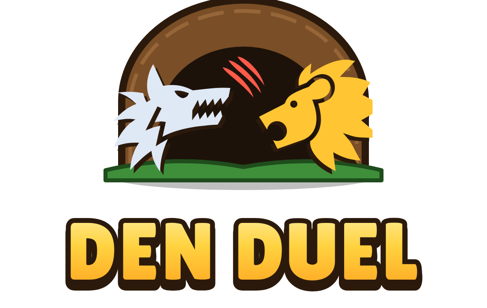

# Den Duel



Den Duel is a real-time animal card battler for iOS and Android, made with Godot 4.
You free animals from cages, build an 8-animal deck and battle other players
to climb through arenas. The rarer the card, the rarer the animal in real life:
Commons are Least Concern species, Legendaries are Critically Endangered.

## What works today

Everything runs offline on your computer, saved on the device:

- **Menus:** five tabs laid out like other mobile card games (Shop, Animals, Battle, Clan, Events)
- **Cards:** 57 animals in 4 rarities, each with stats, an ability and release requirements, plus 6 Ranger tools
- **Deck:** an 8-card battle deck you can edit, plus card leveling with copies and gold
- **Trophies:** 12 arenas on a Trophy Road, and new animals unlock as you climb
- **Cages:** 6 kinds of cage (our chests), with unlock timers, gem skips and a drop-odds screen
- **Ranger level:** an account level, plus player banners, icons and emotes to unlock
- **Shop:** daily animal offers, cages, gold packs and cosmetics
- **Battles** against a computer opponent: animals walk and fight on their own, use their abilities, and attack the enemy's dens, which fight back. Matches last 3 minutes, with double energy in the last minute and sudden-death overtime. Emotes and quick chat work.
- **Look and feel:**
  - an icon for every animal and tool, arena scenery, and dens (side dens and a main den)
  - chunky mobile-game fonts
  - animations: walking, attacks, screen shake and bouncy buttons
  - sound effects and music, which players can switch off
- **Tests:** 70 automated tests for the rules and the battle engine

Not built yet:

- online play and clans
- final illustrated art (the icons are a stand-in, see [docs/ART_DIRECTION.md](docs/ART_DIRECTION.md))
- store purchases

See [docs/ROADMAP.md](docs/ROADMAP.md).

## Run it

1. Install **Godot 4.7** (the *Standard* version, not .NET) from https://godotengine.org/download
2. Get this repository onto your computer. With GitHub Desktop: *File > Clone repository*.
   Until this work is merged, switch to the branch `claude/funny-brown-sxbcoj`.
3. Open Godot, click **Import**, pick `game/project.godot`, then **Import & Edit**.
4. Press **F5** (or the play button in the top right) to run.

The window is phone-shaped, and a mouse click counts as a tap. Tap your banner
in the top left to open your profile. In test builds the profile has
**developer tools**: free gold and gems, trophies, skipping cage timers,
unlocking every animal and resetting your save.

## Play on your iPhone (web version)

The `web-build/` folder is the whole game as a website. It runs in Safari, and
you can add it to your home screen so it opens full-screen like an app.

1. Put it online for free with **Netlify Drop**: on your PC, open
   https://app.netlify.com/drop, sign up (free; "Sign up with GitHub" is
   easiest) and drag the whole `web-build` folder onto the page. You get a
   link like `https://something-random.netlify.app`.
2. Open that link in **Safari** on your iPhone. The game loads in a few seconds.
3. Tap the **Share** button, then **Add to Home Screen**. Den Duel gets its own
   icon and opens full-screen.

Good to know:
- **Saves:** progress is saved in the browser on that device. The home-screen app and a Safari tab keep separate saves.
- **No sound?** Check the ring/silent switch on the side of the iPhone. Safari mutes web audio in silent mode.
- **Dev tools:** the web version is a release build, so the developer tools in the profile are hidden.
- **Updating:** to put a new version online, open your site in Netlify, go to **Deploys**, and drag the new `web-build` folder there. Close and reopen the home-screen app to get it.

**Rebuilding `web-build` yourself** (or just ask Claude): in Godot, open
*Editor > Manage Export Templates* and click *Download and Install* (one time).
Then *Project > Export*, pick the **Web** preset, click *Export Project* and
choose the `web-build` folder, file name `index.html`.

## Run the tests

From the repository root (with `godot` on your PATH):

```bash
godot --headless --path game res://tests/test_runner.tscn
```

## Where things are

```
game/
  project.godot        Godot project settings (portrait, 720x1280, mobile renderer)
  data/                ALL game content as JSON: animals, arenas, cages, emotes, art.json...
  art/                 Icons (game-icons.net) and fonts
  audio/               Sound effects and music (generated by tools/make_sounds.py)
  scenes/              main.tscn (menu) and battle.tscn
  scripts/
    autoload/          GameData (loads data/) and Profile (the player's save)
    rules/             Pure game rules: trophies, leveling, cages, release requirements
    ui/                Menu screens, popups, cards, the cage opening
    battle/            Battle engine, abilities, tools, the bot and the battle screen
  tests/               Automated tests for the rules
web-build/             The game exported as a website (see "Play on your iPhone")
docs/
  GAME_DESIGN.md       How every system works and why
  ROADMAP.md           What's next, and what you need to do
  ART_DIRECTION.md     The current look, the plan for final art, and name ideas
tools/
  import_icons.py      Copies the icons listed in art.json into the game
  make_sounds.py       Regenerates every sound effect and music loop
CREDITS.md             Who made the icons and fonts (required by their licenses)
```

## Changing game content

You don't need to touch code to add or rebalance content. Edit the JSON
files in `game/data/`:

- **New animal:** copy an entry in `animals.json` and change it. Its `unlock_arena` must be an arena id from `arenas.json`, and its tags must exist in `tags.json`. The ability `id` must be one of the types the battle engine knows (listed in `scripts/battle/battle_abilities.gd`).
- **New tool:** same idea in `tools.json`. The effect ids are listed in `scripts/battle/tool_effects.gd`.
- **Battle tuning** (dens, match length, energy): `battle_rules.json`
- **Cage odds:** `cages.json`
- **Trophy and leveling numbers:** `progression.json`
- **Emotes, quick chats, banners and icons:** their own files
- **Which icon something uses:** `art.json`, then run `tools/import_icons.py`

Run the tests afterwards. `test_game_data` catches typos like an unknown arena
or tag.
