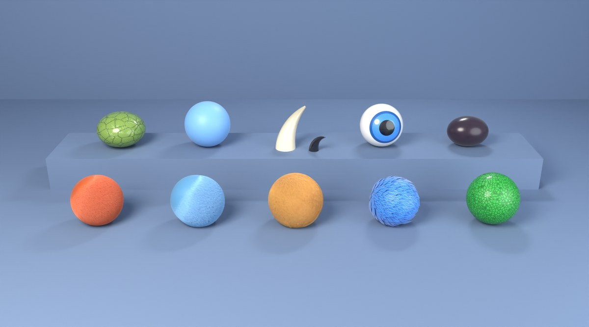

# Art, Sound and Name

## Style guide: the animated-movie pass

Where the animals are going: the craftsmanship of a modern animated movie
with our goofy cartoon personality and our bold, saturated palette. The
quality target is the reference Yeti (a big, simple, appealing shape with
rich, touchable surface detail on top). We take its **craft**, not its
pale, washed-out colors. Numbers live in `tools/creatures/look.json`
("studio", "materials"); the shared materials are
`tools/creatures/materials.py`; `material_sheet.py` renders them all.

### 1. Shape language

Big simple shapes first, detail second: every animal must read as one
appealing shape when filled in solid black. Proportions are pushed about
1.3 to 1.5 times past real life, with contrast between big and small parts
(a huge torso against short legs, a big head against a small muzzle) and
between straight and curved lines. Heads stay a quarter to a third of the
body's height, so faces read on a card.

| Class | Shape | Silhouette | Examples |
|---|---|---|---|
| **Tanks** | Huge chunky bodies: the torso over half the height, thick forearms, short sturdy legs, the head sunk into big shoulders. Slow, heavy, planted. | A boulder or a rounded triangle, wide at the bottom. | Brown Bear, Hippo, Elephant, Black Rhino, Turtle, Panda, Yeti |
| **Tank Destroyers** | Lean and powerful: a deep chest, a narrow waist, long limbs, leaning forward, big jaws or tusks. | A wedge pointing at the enemy. | Lion, Tiger, Wild Boar, Wolf Pack, Honey Badger, Komodo, Cerberus |
| **Ranged** | Smaller and nimble: a light body, a big head and big hands or paws (what they throw or shoot with), big alert eyes, perky ears and tails. | Small, upright, a clear head and hands. | Squirrel, Raccoon, Skunk, Cobra, Orangutan, Camel, Unicorn |
| **Air** | Elegant wings at least twice the body's width, long primary feathers in clean S-curves, a small light body. | A V or an arrow in flight, a teardrop at rest. | Falcon, Owl, Harpy Eagle, Macaw, Condor, Dragon |
| **Specialists** | Distinctive and quirky: one exaggerated signature feature. | That feature, first. | The Fox's huge tail, the Pangolin's plates, the Sloth's long arms, the Eel's zigzag, the Gorilla's chest, the Seal's round belly, the Red Panda's ringed tail, the Kraken's tentacles |
| **Mythics** | Grand and impressive: a heroic upright posture, the biggest presence on the field, and one magical element that glows. | Tall and crowned. | Yeti's frost horns, Cerberus's three heads with ember eyes, Unicorn's rainbow mane and horn, Dragon's wings and glowing throat, Kraken's glowing suckers |

### 2. Material library

(`tools/creatures/material_sheet.py`: front row short, long and fluffy fur,
feathers, scales; back row shell, skin, horn and claw, eye, nose.)

Every animal is built from the same materials, each starting from a color
in our palette and adding the craftsmanship: shading from root to tip,
grooves, gloss. Never a pale or gray-washed version of the color.

- **Fur** (short, long, fluffy): real strands for hero art, groomed into
  clumps (child strands gathered round each guide), combed down and back,
  darker at the root and lighter at the tip, each strand a shade
  different. Short: a fox's sleek coat. Long: a yeti's or bear's shaggy
  coat that hangs. Fluffy: soft, slightly curly down (a panda's, a
  chick's). The skin under the fur is a deeper shade of it, so the gaps
  between clumps read as soft shadow.
- **Feathers:** overlapping cards laid along the body like shingles, each
  bending to follow the body, darker at the base with a pale edge, a stiff
  pale shaft and fine barbs, with a soft sheen.
- **Scales:** small domed cells with deep grooves between, each a slightly
  different shade, a light waxy coat.
- **Shell:** big plates with grooves and growth rings, a glossy coat.
- **Skin** (faces, hands, noses, bellies): soft and a little translucent,
  faint mottling, a soft sheen. Noses darker and glossier.
- **Horns, tusks, claws:** horn and tusks ivory to a darker tip with fine
  ridges and a satin shine; claws and nails dark and glossy.
- **Eyes:** see 4.

### 3. Lighting

One studio setup for every hero render, so every animal belongs to the
same game (look.json "studio"):
- A big **soft key light** from the front-left above, warm white: gentle
  shadows, no harsh white glare.
- A soft **cool fill** from the right, so shadows keep their color.
- A **rim light** from behind that traces the silhouette (this, not an
  outline, separates the animal from the background in hero art).
- A soft **sky** all round that fills creases and the gaps between fur
  clumps with soft occlusion.
- A soft **contact shadow** under the feet.

The battlefield matches it: the same key direction (top-left on screen),
the same warm-key and cool-fill split, and a soft shadow under every
animal.

### 4. Eyes and faces

- Eyes have a colored iris (each species its own), a big pupil and a
  glossy cornea, so the key light puts a crisp **catchlight** in the upper
  left of every eye. Whites are a warm off-white. No more flat white
  googly circles: eyes are smaller than today's, set into the face, with
  lids.
- Every face has readable features at card size: a clear muzzle shape, a
  mouth line with corners that can smile, and brows (a ridge or a fur
  tuft) that carry the expression.
- An expression set every animal shares: friendly (idle), determined
  (wind-up), ouch (hit), proud (victory), dizzy (defeat). The goofiness
  stays in the expressions and reactions, cleanly drawn.
- Heads turn three-quarters toward the camera in portraits.

### 5. Outlines

- **Hero art** (card portraits, the 3D viewer, cage reveals, the VS
  screen): **no drawn outline**, like the reference. The rim light and the
  contact shadow separate the animal from its background.
- **Battlefield:** keeps the bold team-colored band and a dark inner line,
  for reading who's who in a big army.
- UI icons and badges keep their outlines.

### 6. Two levels of detail

- **Hero art:** full detail (strands, feather cards, grooves), rendered in
  Cycles at 512 pixels or more.
- **Battlefield models:** the same design and colors, simplified for the
  size they're seen at (about 60 to 110 points tall on an iPhone): fur as
  a few big, chunky sculpted clumps in the mesh instead of strands,
  feathers as a few big layered shapes, scales and shell as painted
  pattern, and the soft occlusion between clumps baked into the model's
  colors. Shading is soft and smooth, lit like the hero art. No detail
  smaller than a few screen pixels, so nothing shimmers. Only the animals
  in a match are loaded (as now).

### 7. Animation and effects (for the later steps)

- Animation: anticipation (a clear wind-up before every attack), timing
  and weight by size, follow-through and overlap (fur, ears, tails,
  bellies settle after the motion), arcs, controlled squash and stretch,
  and personality in every idle, attack, hit, victory and defeat.
- Effects: every one in three phases (build-up, impact, fade), layered (a
  bright core, a softer glow, particles, a shockwave for big hits), one
  look per element (ice, fire, rainbow light, lightning, venom, ink, dust),
  strong clear shapes, the Mythics' the biggest, all bright and solid and
  60 fps on an iPhone with big armies.

## Where the look is now

**The Yeti is the first animal on the animated-movie look** (the style
guide above). It is built by `tools/creatures/movie.py` from its design in
`tools/creatures/movie.json`: the cartoon's shape with gentler proportions,
a bare blue face with a muzzle, a nose and a grin, eyes set under a brow
with a blue iris and a catchlight, fingers and toes with dark glossy nails,
horns swept back, and a shaggy white coat with icy-blue shadows. Its card
portrait grows real groomed fur strands and uses the material library and
the studio lights, with no outline. Its real-time models carry the same
coat as sculpted locks in the mesh: about 560 fine ones for the 3D viewer
(33,000 triangles, 1.5 MB, from 21,000 and 0.9 MB) and 70 chunky ones for
the battlefield (5,400 triangles, 318 KB, from 3,400 and 227 KB), drawn by
their own shader (`game/scripts/fx/model_movie.gdshader`, values in
`game/data/viewer.json` "movie_look") with the studio lighting, strand
detail that fades out before it can shimmer, and eyes with an iris. In
battle it keeps the dark line and team band, drawn round the animal's
edge and not round every lock.

**The Komodo Dragon and the Peregrine Falcon followed** (the scales and
feathers of the material library). The Komodo is scaly all over: bold
green with a sandy belly and orange flecks, an amber eye under a brow, a
grin and a pink forked tongue, bigger claws; its portrait uses the domed
scales material and its real-time models' shader draws the scale cells
from the model's own shape (no extra geometry or memory: 21k triangles and
0.9 MB in the viewer, from 24k and 1.0 MB). The Falcon keeps its own markings in the
bold palette (a navy helmet, a steel-blue back, a cream barred breast,
yellow feet), with feather cards laid over its body like shingles: 650
small ones in the portrait, 240 bigger ones in the viewer (20k triangles
and 0.9 MB, from 18k and 0.75 MB) and 40 chunky ones in battle (3.1k
triangles and 205 KB, from 2.9k and 182 KB), each shaded darker at the
base with a pale edge and shaft by the shader.

**The Yeti moves and strikes like a movie character** (step 4; the
principles in section 7 of the style guide). Its animations are its own
(`tools/creatures/motion.py`, a "persona" picked in `movie.json` "motion"):
an idle of slow deep breaths that lift the shoulders, a sway from foot to
foot with the long arms swinging a beat behind, and a slow look about; a
fidget that shakes the snow off and then stretches and yawns; a victory
that beats its chest and flings both arms up with a roar and a hop. Its
pound is built on anticipation and weight: it rocks back and hauls both
fists overhead, slowing into a beat of hang time, then pitches forward and
slams both fists down, squashing low, the head and shoulders overshooting
and bouncing back before it settles. Its ability effect has three phases
(`game/scripts/fx/fx_layer.gd` "ice_blast", numbers in `game/data/feel.json`
"styles"): the build-up, frost gathering onto its fists during the wind-up
before a pound; the impact, a white core flash, an icy glow, a shockwave
ring racing out, ice shards bursting up out of the ground round it, frost
cracks across the ground, snow thrown up and a shake; and the fade, the
shards melting back as the frost patch it leaves settles in. An enemy
frozen on the frost gets a smaller burst of the same.

**The Tanks followed** (the first rollout batch): the Brown Bear in a
shaggy warm-brown coat with grizzled tips, clawed toes and a grin; the
Giant Panda in fluffy white and black with its eye patches; the Hippo,
Elephant and Rhino in bold leathery skin (surface "skin": wrinkle folds
bumped into the hero renders, ivory tusks and horns, toenails); the
Snapping Turtle with a mossy plated shell (the shell material on the
shell's faces, the painted scute lines kept) over scaly skin. All keep
their own markings, re-colored into the bold palette (movie.json "paint":
"species" with a palette swap). Their models carry fur locks only where
there is fur (the Bear and Panda: about 1,000 fine overlapping locks, 51k
triangles in the viewer and 6.4k in battle, from 21k and 3.3k; the
viewer shows one animal at a time, so that is the one place the budget
is spent); the skin animals grew only by their toes and tusks (4.2k in
battle, from 3.3k) and the Turtle not at all. The lock tips brighten in
their own hue, never toward white: on a brown or black coat, white-mixed
tips read as pale flecks, and short sparse locks read as bumps; a coat
reads as fur when the locks are long, flat, overlapping and dense. The
other animals keep the flat cartoon look below until they move over.

**Animals are 3D cartoons.** Like Clash Royale, the game is 2D but its
characters are 3D models rendered into sprites, so they look solid and
lit. They are cartoons of the real animals: big heads with big googly
eyes, short chunky legs, round bodies, smooth bright skin and a dark
outline, while keeping each species' shape and markings. Every animal is
built, painted, rigged, animated and rendered by our own Blender pipeline
in `tools/creatures/` (how it works:
[tools/creatures/README.md](../tools/creatures/README.md)). Nothing is hand
modeled, so any animal can be rebuilt or tweaked by editing its file in
`tools/creatures/species/`, and the whole cartoon look is tuned in one
place (`tools/creatures/cartoon.py`).

- **Real markings:** each species starts from real measurements
  (shoulder height, body and tail length) and keeps its real coat: the
  fox's black stockings and white tail tip, the tiger's tapering stripes, the leopard's
  broken rosettes, the cheetah's tear lines, the wild dogs' painted patches,
  the raccoon's mask, the condor's bare head and white underwing.
- **Cartoon faces:** big round white eyes with black pupils and a shine,
  mouths that open on a bite (with fangs or tusks for the cats and hippo).
- **Animations:** idle, walk (trot, walk or gallop), attack and death. Attacks
  fit the animal: pounce and bite (fox, cats), bite (wolves, rats, hippo),
  swipe (bears, raccoon, red panda), charge (boar, bison, rhino), stomp with
  the trunk raised (elephant), sit up and throw (squirrel), stoop and strike
  (falcon, condor).
- **In battle:** sprites from 8 directions (5 rendered, 3 mirrored), 56
  pixels per tile, a soft shadow under each animal, a team-colored ring at
  its feet. A played animal drops onto its spot with a puff of dust. The
  game times each attack so the hit lands on the strike frame, with a hit
  effect that fits it (claw slashes, a bite, dust from a charge or stomp,
  feathers from a strike). A fallen animal topples over and lies still for
  a moment before fading.
- **Cards:** a rendered three-quarter portrait of each animal, framed so
  the whole animal fits.

**Arenas are rendered too** (`tools/creatures/arena.py`), one picture per
arena: an open grass field with faint tile stripes, a worn halfway line and
center ring, a low fence all the way around, and themed scenery outside it
(pines in the Whispering Woods, cacti and red rocks in the canyon, snowy
pines in the tundra, palms on the coast...). They use the same 50-degree
camera as the animals, with the ground stretched so tiles still land
exactly where the game puts them. The menus show a window onto your arena
with two animals from it squaring up on each side.

(The old mode's treehouse dens, `tools/creatures/treehouse.py`, are no longer
in the game; the script is kept in case dens come back as scenery.)

**In the game, the animals get a fake-3D finish and smooth motion** on top
of their rendered frames (`game/scripts/fx/`):
- A shader on every animal (`unit.gdshader`): a warm highlight on the edge facing the light (always top-left on screen, even for mirrored sprites), a cool rim light on the far edge, soft volume shading across the body, outlines recolored to a dark shade of the animal's own colors and thickened a pixel, a little extra color punch, and a pure white flash when hit.
- Motion (`unit_view.gd`): breathing and bobbing, walking hops with squash and stretch, a lean into the run, a wind-up and a lunge on every attack, a springy squash and knockback when hit, an elastic pop-in, hops when moved, and cartoon defeats (a hop, a spin and a poof cloud with stars).
- Movement on screen is separate from the fight: an animal is drawn where the fight has it, followed by a spring so it eases into and out of a run; nudged apart from animals it would cover (`battle_field.gd`, the pictures are bigger than the room each takes in the fight); facing where it walks or what it fights, turning at a cartoon pace and never turned by a push; walking only when it moves on its own, with its legs in step with the ground. A row marches as a loose crowd. Numbers in `feel.json` "movement".
- Acting (`unit_view.gd`, `unit_face.gd`, numbers in `feel.json` "acting"): each class moves its own way (Tanks plod with a thump and a puff of dust at each step and take big slow swings; Tank Destroyers lean in, crouch and pounce; Ranged kick back on every shot; fliers bob, swoop, bank into turns and dive in and pull back up). Animals blink, fidget now and then (a rendered look-around and head shake), alternate two attacks if they're common, flinch and bounce when hit, wobble when stunned, move in slow motion when slowed, sweat when nearly beaten, trip now and then, look smug after a knockout and celebrate when their herd wins (a rendered victory). Faces are drawn over the rendered eyes (where they are in each frame comes from the sprite sheet): a squint on the wind-up, wide eyes when hit, dizzy swirls when stunned or knocked out, drowsy lids when slowed, happy eyes when celebrating. A knockout poofs, or bounces off the screen with a spin. Every animal has a rendered fidget and eye data, and Common animals a second attack; Stun animals have a rendered wind-up for the blow that stuns (a chest beat, a hiss, a roar). Brown Bear, Lion and Peregrine Falcon also have a rendered victory; the rest celebrate with bounces and a spin through their drawn directions. Specialist traits act in the game: Burrow animals sink into the ground and pop out with a boing, Splash animals belly-flop with a splash ring, Slow animals wind up with a lazy yawn. Body plans walk their own way (fish wiggle, upright animals waddle, snakes ripple, frogs bound, seals slide).
- Choreography (`feel.json` "choreography"): a fight opens with both herds hopping into place and a bouncy FIGHT! banner; a dragging ending with few animals left gradually plays faster (never changing what happens); the last knockout plays in slow motion with a push-in, then the winners celebrate and the score pops up. Health bars show once an animal is hurt and fade away when it hasn't been hit for a while.
- Sprite sheets (version 3) crop each animation to its own frame size, so a big pose doesn't make every frame bigger, and pack frames tightly; the unused death frames are left out.
- Hits land on the strike: the fight deals a hit, the attacker's wind-up plays (started then if none was showing), a shot flies if it's thrown, and only then do the flash, sparks, number, health-bar drop and any knockout show.
- Effects (`fx_layer.gd`, `particle_layer.gd`): hit sparks, hit-stop and screen shake on big hits and knockouts only, bouncy damage numbers, chunky health bars with a delayed "damage taken" bar, glowing projectile trails, sparkles, stars, puffs, confetti and coins.
- The arena is toned down a little (`ground.gdshader`) so the animals pop, with drifting cloud shadows, swaying grass and petals, leaves or snow to suit it.
- Every number is in `game/data/feel.json`.

**The menus** are a chunky cartoon style, built in code so the whole look
lives in `scripts/ui/ui_kit.gd`:
- **Buttons** have a pressable colored edge, a gloss and a soft shadow, and sink when pressed (`button_skin.gd`).
- **Panels** are raised (a lighter rim and a drop shadow) or sunken for lists and stats. Text is bold and outlined in deep navy with a drop shadow.
- **Cards** (`animal_card.gd`): a glossy rim in the rarity's color (steel silver Common, orange Rare, purple Epic, teal Legendary, rose pink Mythic), the animal's portrait in a spotlight of its habitat color, a name plate, and a level badge with a progress bar that turns green when an upgrade is ready. In Draft Duel (`game_card.gd`) a card shows only the art, its class badge in the top-left corner, its stars and, when a pick would add a star, a green arrow. The rarer the card, the bigger its show (a Rare's soft shine up to a Mythic's shimmering border, sparkles and light rays; see GAME_DESIGN.md, Card show).
- **The menu background** is a deep blue gradient with faint paw prints; the bottom bar has an icon per tab, and the chosen tab lifts up.
- **Icons:** white silhouettes from [game-icons.net](https://game-icons.net) (free to use with credit, see [CREDITS.md](../CREDITS.md)) for tools, emotes, player icons, tabs and buttons.
- **Rival Ranger portraits** (`ranger_portrait.gd`): placeholders drawn in code from each rival's `look` in `rivals.json` (skin, hair and hat styles, eyes, mouth, glasses or freckles...), lit from the top left with a cool rim on the right and outlines in a dark shade of each part's color, on the rival's banner colors. Their face changes with their mood (happy, sad). An illustrator could replace them with painted heads later.
- **Logo:** a wolf and a lion facing off in a den entrance, above "DEN DUEL" in Lilita One. The PNGs are in `game/art/logo/`, the editable SVGs in `game/art/logo/source/`.
- **Fonts:** **Lilita One** for titles and buttons and **Nunito** for longer text.
- **Sounds and two music loops:** generated by `tools/make_sounds.py`.

## Design system: "Ranger Camp" (in progress)

Summer camp, ranger stations, wooden trail signs and brass: warm, chunky and
toy-like. One look for every screen, from `game/data/ui_style.json` through
`game/scripts/ui/style/`. Screens use these and never pick their own colors or
sizes. So far the Draft Duel shop uses it; the rest of the screens move over next.

- **Materials:** painted wood panels with soft grain, painted-wood buttons with a
  gloss, brass for money, a wooden trail-sign plank for titles, sunken dark-wood
  wells. They're drawn by `tools/make_ui_art.py` into `game/art/ui/` as grayscale
  nine-slice shapes (outline, lip, bevel lit from the top left, grain, soft
  shadow) plus a white shine, at 2x for sharp edges on 3x iPhone screens, and
  tinted in the game with the colors in `ui_style.json`. Run the script again
  after changing it; `skins.json` holds each piece's slice margins.
- **Palette:** warm summer sky to sunshine behind everything, wood browns, leaf
  green for the main action, sky blue, barn red for danger, purple for tools,
  brass/gold for rewards, dark brown outlines, and a frame color per rarity.
  The home screen keeps its blue look: a bright sky-blue backdrop with deep,
  saturated blue panels, each with a bright rim. **Every color lives in
  `ui_style.json`** ("colors"): the Ranger Camp pieces, the home screen's blues
  (`kit_*`), rarities (`rarity_*`), classes (`class_*`), habitats
  (`habitat_*`), sorting and a few one-off pieces; rarities.json, classes.json
  and habitats.json have none of their own. All of them are solid and
  saturated: nothing is see-through. Disabled and locked things are solid but
  muted (a gray button, an arena you haven't reached in muted tones), never
  faded; an enabled button is never gray.
- **Light:** no full-screen grade or vignette (they browned and darkened
  everything); a warm glow around picked things; brass icons catch a glint
  now and then.
- **Text:** four sizes only (26, 32, 44 and 64 px, which is 14, 17, 24 and 35 pt
  on an iPhone). Titles, numbers and buttons are in Lilita One with a thick
  dark-brown outline and a drop shadow; the few longer lines are in Nunito.
- **Spacing:** 8, 16, 24 or 32 px. Every corner is rounded.
- **Components:** `SkinBox` (a skin as a style box: one draw call),
  `ChunkyButton` (primary, secondary, danger, tool, gold; at least 88 px tall;
  squashes on press, bounces back, pops with a sparkle; the main one breathes),
  `ValuePill` (icon and a number that ticks; brass for money), `GameCard`
  (rarity frame, big art in a habitat-lit window, a brass cost coin, habitat
  badge, stars).
- **Particles** (sparks, stars, coins, confetti, leaves, dust...) are cells of
  one sheet, `game/art/ui/particles.png`, drawn as a single MultiMesh.
- **Motion:** screens change with a leafy circle wipe and a swirl of leaves
  (`Transition`); shop cards bob out of step and pop in one after another; a
  bought card flies to your herd and lands with a squash and a puff of dust;
  a star added flashes and bursts. Every timing is in `feel.json`.
- **Sound:** wood knocks, soft pops, brass clinks, marimba and glockenspiel
  chimes, soft whooshes; music with a whistled tune, ukulele and marimba
  (`tools/make_sounds.py`).

## What's next for the art

1. **Play with the 20 animals and react:** which ones don't look right, which
   animations feel weak. Each one is a file to tweak and re-render (about
   10-15 minutes per animal, or a few minutes to redo one animation).
2. **The rest of the world in the same style:** the tools' effects, the
   cages and the menu backgrounds could also be rendered 3D.
3. **More animals** from `game/data/animals_later.json`, once these 20 feel
   right. Most reuse an existing body plan (four-legged, bird); snakes,
   turtles and primates need new ones.
4. **Optional: an artist.** For a hand-painted finish, an illustrator could
   paint over the renders, especially the card portraits. Ask for a paid test
   of 2-3 cards first, and get the rights to the art in writing.

## Name

**Den Duel** is the name. A web search found no game or app with that name on
the App Store, Google Play or Steam. Before launch, still check the USPTO
trademark database (tmsearch.uspto.gov) and grab a matching website name
and social handles.

The other ideas we considered, for reference:

| Name | Why it fits |
|---|---|
| **Uncaged** | The cages, freeing animals. Short and punchy |
| **Wild Release** | "Release" is already the in-game word for playing an animal, plus freeing them |
| **Last of Their Kind** | The rarity = endangered idea. Memorable, a little long |
| **Wildcard Rangers** | A pun: wild animals plus cards, and you're a Ranger |
| **Rescue Rumble** | Playful, says "battles" and "animals" |
| **Sanctuary Showdown** | Ties to the top arena, Last Sanctuary |

